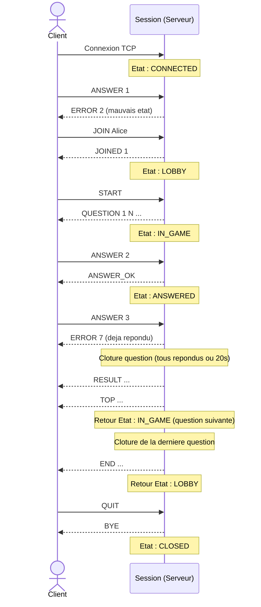
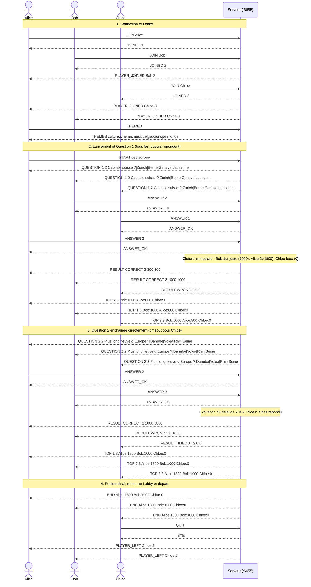
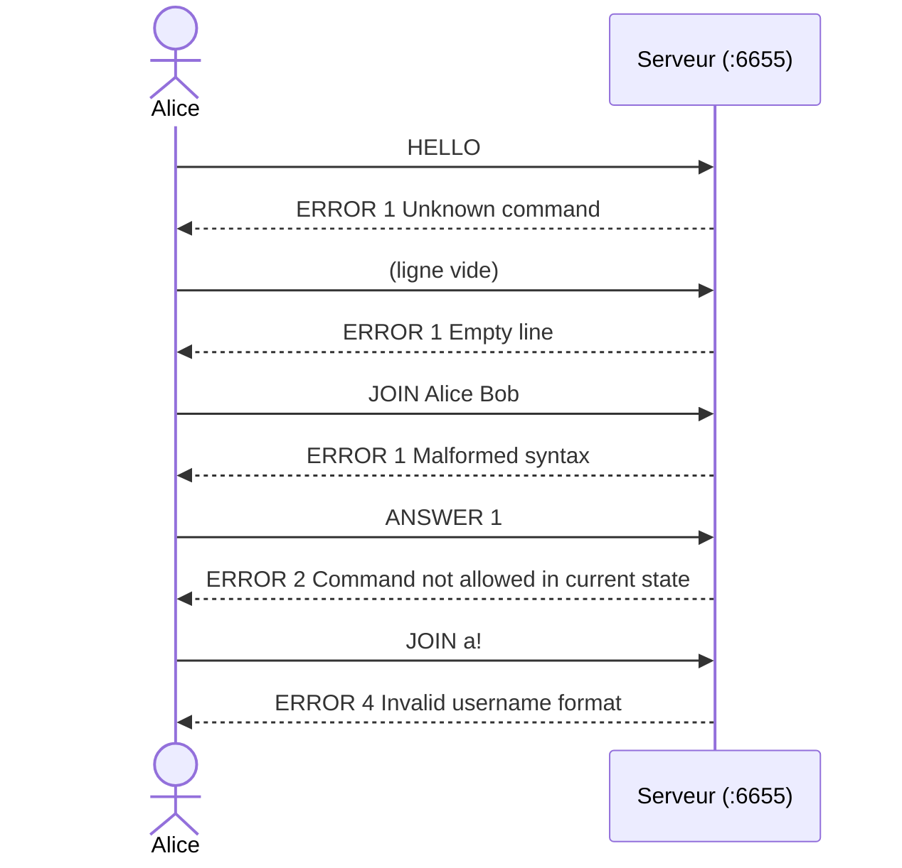
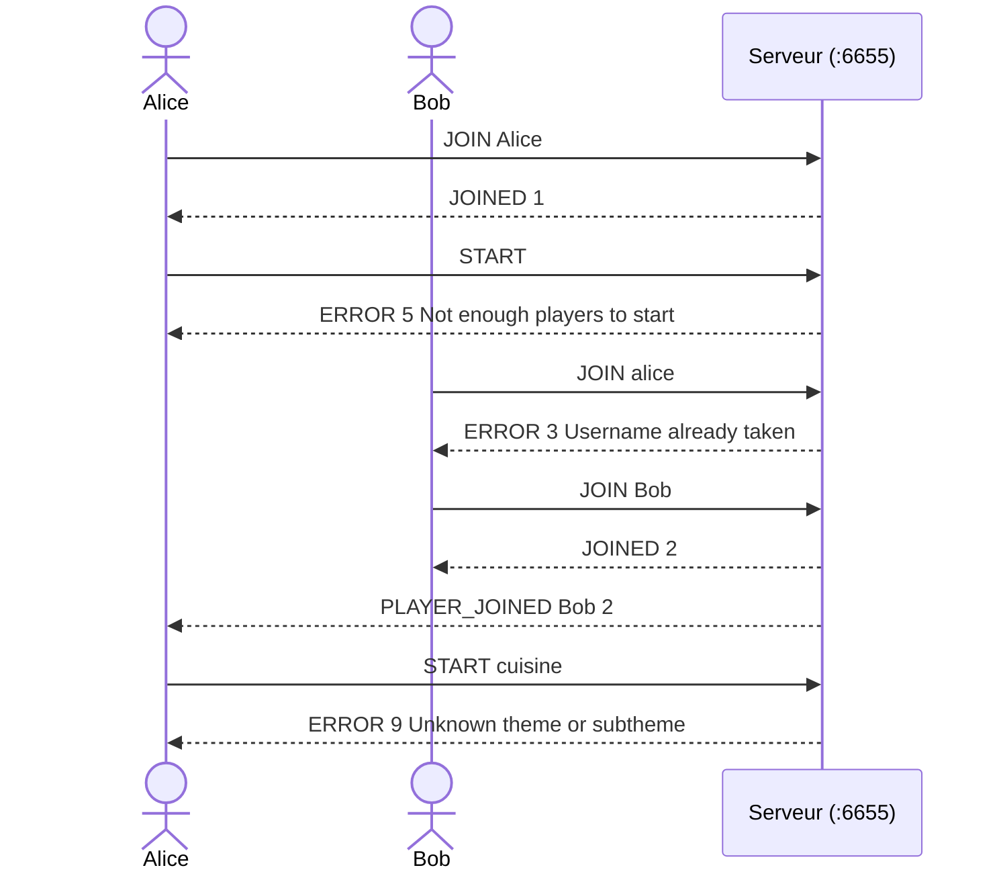
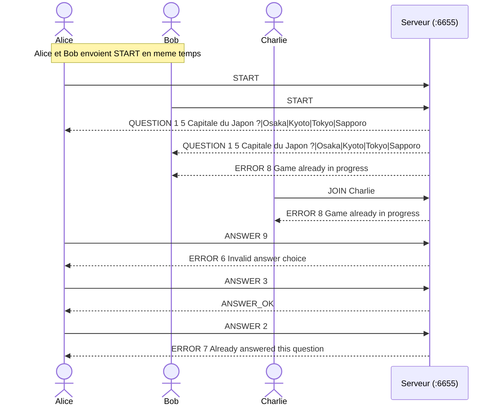

# Spécification du protocole applicatif – Quiz Multijoueur

Ce document décrit le protocole applicatif utilisé entre le serveur et les clients de notre jeu de quiz multijoueur. Les règles métier propres au jeu (barème des points, nombre de questions par partie, départage des égalités et banque de questions) sont documentées à part dans la section **Règles du jeu** du `README.md`.

## 1. Vue d'ensemble

Le jeu repose sur une architecture **client-serveur** dans laquelle un serveur unique héberge une seule partie à la fois et accepte plusieurs clients simultanément. Puisque le serveur centralise le déroulement de la partie, c'est lui qui fait autorité sur l'ensemble des états (liste des joueurs, tirage des questions, chronomètre, validation des réponses et calculs envoyés aux clients).

Une session client se déroule en trois phases :

- **Lobby :** Un joueur se connecte au serveur et choisit un pseudo unique grâce à la commande `JOIN`. Les autres joueurs déjà présents sont immédiatement informés de son arrivée via `PLAYER_JOINED`. Tant que la partie n'a pas débuté, il est possible de consulter les thèmes disponibles avec `THEMES`. Dès qu'au moins 2 joueurs se trouvent dans le lobby, n'importe lequel d'entre eux peut lancer la partie avec `START` (avec ou sans filtre de thème). Il n'est pas possible de rejoindre une partie déjà lancée.

- **Partie :** Le serveur envoie les questions les unes après les autres (`QUESTION`), chacune proposant 4 choix. Chaque question prend fin dès que tous les joueurs encore présents ont répondu (`ANSWER`) ou à l'expiration du délai de 20 secondes. Le serveur transmet alors à chaque joueur son résultat personnel (`RESULT`) suivi du classement provisoire (`TOP`), puis enchaîne directement avec la question suivante.

- **Podium et retour au lobby :** À la fin de la dernière question, le serveur diffuse le podium final (`END`). Tous les joueurs encore connectés reviennent automatiquement dans le lobby afin de pouvoir relancer une nouvelle partie sans se reconnecter.

## 2. Protocole de transport

Le transport repose sur **TCP** (*Transmission Control Protocol*). Ce choix vient des trois besoins suivants :

1. **Fiabilité :** Les commandes envoyées par les joueurs (`JOIN`, `START`, `ANSWER`) ainsi que les messages du serveur (`QUESTION`, `RESULT`, `TOP`, `END`) ne peuvent pas être perdus sans fausser la partie ou bloquer un client. TCP garantit la retransmission des paquets perdus et l'intégrité du flux.

2. **Ordre de livraison :** Le déroulement du quiz impose un ordre strict entre les messages (`QUESTION`, puis `RESULT`, puis `TOP`, puis `END`). TCP assure que les données arrivent à l'application dans l'ordre exact de leur émission.

3. **Détection de déconnexion :** Comme TCP maintient une connexion persistante, le serveur peut détecter le départ d'un joueur (via `QUIT` ou via la fermeture de sa socket) afin de le retirer de la partie sans bloquer les autres participants. Une coupure réseau brutale sans fermeture TCP propre n'est toutefois détectée que lors d'une tentative d'écriture ou d'une connexion réseau expirée.

### Fonctionnement de la connexion

- **Ouverture :** Le client ouvre la connexion TCP et la conserve pendant toute sa session. Le client envoie le premier message ; le serveur n'envoie aucun message d'accueil à la connexion.

- **Messages spontanés :** Une fois entré dans le lobby, le client peut recevoir des messages du serveur à tout moment (`PLAYER_JOINED`, `PLAYER_LEFT`, `QUESTION`, `RESULT`, `TOP`, `END`). Le client doit donc écouter la connexion en continu.

- **Fermeture :** Qu'un joueur quitte proprement avec `QUIT` ou que sa connexion coupe brutalement, le traitement vis-à-vis des autres joueurs reste identique (envoi de `PLAYER_LEFT`).

## 3. Port et encodage

- **Port par défaut :** Le serveur écoute sur le port TCP `6655`. Ce port reste modifiable côté serveur et côté client via l'option `--port` (ou `-p`).

- **Encodage :** Tous les échanges utilisent **UTF-8 sans BOM** dans les deux sens, quel que soit le système d'exploitation. Le BOM (*Byte Order Mark*) correspond à 3 octets invisibles (`EF BB BF`) parfois ajoutés automatiquement au début d'un texte par certains outils (notamment sous Windows) ; puisqu'ils fausseraient la lecture de la première commande, ils sont interdits.

- **Octets UTF-8 invalides :** Si une ligne reçue contient une séquence d'octets impossible à décoder en UTF-8, le serveur la rejette avec `ERROR 1 Invalid UTF-8`.

## 4. Délimitation des messages

Puisque TCP fonctionne comme un flux d'octets continu (une lecture réseau peut contenir seulement un morceau de message ou plusieurs messages collés), chaque message est délimité par un retour à la ligne :

- **Caractère de fin :** Chaque message se termine obligatoirement par `\n` (`0x0A`).

- **Tolérance `\r\n` :** Le client et le serveur envoient toujours `\n`. Par tolérance envers certains clients (Windows ou `telnet`), le récepteur accepte `\r\n` (`0x0D 0x0A`) en supprimant simplement le `\r` final avant l'analyse.

- **Taille maximale :** Un message ne peut pas dépasser `1024` octets, `\n` compris. Si un client dépasse cette limite avant d'envoyer `\n`, le serveur répond `ERROR 1 Line too long` et ignore les octets suivants jusqu'au prochain `\n`.

- **Ligne vide :** Une ligne ne contenant aucun caractère avant `\n` (ou uniquement `\r`) est rejetée avec `ERROR 1 Empty line`.

- **Fermeture en cours de ligne :** Si la connexion se ferme avant la réception d'un `\n`, les octets incomplets reçus sont ignorés.

## 5. Syntaxe générale

Un message suit toujours la structure suivante : `COMMANDE [arg1] [arg2] ...`.

- **Commandes :** Les mots-clés sont écrits en **MAJUSCULES** et sont sensibles à la casse. Par exemple, `join Alice` est rejeté avec `ERROR 1 Unknown command`.

- **Séparateur d'arguments :** Un unique espace standard (`0x20`) sépare la commande de chaque argument. Aucun espace n'est autorisé en début de ligne, en fin de ligne ou en double.

- **Séparateur de texte (`|`) :** Puisque l'énoncé d'une question et ses quatre choix contiennent des espaces, le message `QUESTION` utilise le caractère `|` pour les séparer. Il n'existe aucun mécanisme d'échappement.

### Contraintes sur les champs

- **Pseudo (`<pseudo>`) :**
  - **Règle :** Entre 3 et 12 caractères, uniquement des lettres non accentuées (`A` à `Z`, `a` à `z`) et des chiffres (`0` à `9`), sans espace ni caractère spécial (expression régulière : `^[A-Za-z0-9]{3,12}$`).

  - **Unicité :** La comparaison est insensible à la casse (`Bob` et `bob` représentent le même pseudo), mais le serveur conserve la casse d'origine pour l'affichage.

- **Thème et sous-thème (`<theme>`, `<sous_theme>`) :**
  - **Règle :** Entre 2 et 20 caractères, uniquement des lettres minuscules non accentuées (`a` à `z`), des chiffres (`0` à `9`), le tiret `-` ou le tiret bas `_` (expression régulière : `^[a-z0-9_-]{2,20}$`).
  - **Normalisation :** Les valeurs envoyées dans `START` sont converties en minuscules côté serveur (`Geo` est traité comme `geo`).

- **Textes des questions et des choix (`<texte>`, `<choix1..4>`) :**
  - **Caractères interdits :** Le séparateur `|` ainsi que tous les caractères de contrôle non imprimables (saut de ligne `\n`, retour chariot `\r`, tabulation, caractère nul, soit les codes Unicode `U+0000` à `U+001F` et `U+007F`).
  - **Bornes :** Un champ ne peut pas être vide et ne peut ni commencer ni se terminer par un espace.

## 6. Catalogue des messages

### 6.1 Messages Client → Serveur

#### `JOIN`

Permet à un client connecté d'entrer dans le lobby avec un pseudo.

- **Syntaxe :** `JOIN <pseudo>`
- **Paramètres :** `<pseudo>` respectant les contraintes de la section 5.
- **État requis :** `CONNECTED` (et aucune partie en cours).
- **Réponses possibles :**
  - `JOINED <nb_joueurs>` au client + `PLAYER_JOINED <pseudo> <nb_joueurs>` aux autres joueurs du lobby (le client passe à `LOBBY`).
  - `ERROR 1` : nombre d'arguments incorrect ou espaces invalides.
  - `ERROR 2` : le client est déjà dans le lobby ou en partie.
  - `ERROR 3` : le pseudo est déjà utilisé par un autre joueur.
  - `ERROR 4` : le format du pseudo est invalide.
  - `ERROR 8` : une partie est déjà en cours.
- **Exemple :**
  - Client → Serveur : `JOIN Alice\n`
  - Serveur → Alice : `JOINED 2\n`
  - Serveur → Bob : `PLAYER_JOINED Alice 2\n`

#### `THEMES`

Demande la liste des thèmes et sous-thèmes disponibles sur le serveur.

- **Syntaxe :** `THEMES`
- **Paramètres :** Aucun.
- **État requis :** `LOBBY`.
- **Réponses possibles :**
  - `THEMES <catalogue>` au client demandeur.
  - `ERROR 1` : arguments inattendus.
  - `ERROR 2` : commande envoyée hors de l'état `LOBBY`.
- **Exemple :**
  - Client → Serveur : `THEMES\n`
  - Serveur → Client : `THEMES culture:cinema,musique|geo:europe,monde\n`

#### `START`

Lance une nouvelle partie pour l'ensemble des joueurs présents dans le lobby.

- **Syntaxe :** `START [theme [sous_theme]]`
- **Paramètres :**
  - `theme` *(optionnel)* : limite les questions à un thème précis.
  - `sous_theme` *(optionnel, requiert `theme`)* : limite les questions à un sous-thème précis.
  - Sans argument : tirage dans toute la banque de questions.
- **État requis :** `LOBBY` avec au moins 2 joueurs connectés.
- **Réponses possibles :**
  - Diffusion immédiate de `QUESTION 1 <total> ...` à tous les joueurs (tous passent à `IN_GAME`).
  - `ERROR 1` : plus de 2 arguments ou espaces invalides.
  - `ERROR 2` : commande envoyée avant `JOIN` (état `CONNECTED`).
  - `ERROR 5` : moins de 2 joueurs présents dans le lobby.
  - `ERROR 8` : une partie est déjà en cours (inclut le cas de deux `START` simultanés : le second reçoit `ERROR 8`).
  - `ERROR 9` : le thème ou le sous-thème demandé n'existe pas.
- **Exemples :**
  - Client → Serveur : `START\n`
  - Client → Serveur : `START geo\n`
  - Client → Serveur : `START geo europe\n`

#### `ANSWER`

Envoie la réponse du joueur pour la question en cours.

- **Syntaxe :** `ANSWER <choix>`
- **Paramètres :** `<choix>`, un entier compris entre `1` et `4`.
- **État requis :** `IN_GAME`.
- **Réponses possibles :**
  - `ANSWER_OK` au client (qui passe à `ANSWERED`). Si ce joueur était le dernier attendu, le serveur clôture aussitôt la question et envoie `RESULT` puis `TOP`.
  - `ERROR 1` : nombre d'arguments différent de 1.
  - `ERROR 2` : commande envoyée hors partie (`CONNECTED` ou `LOBBY`).
  - `ERROR 6` : `<choix>` n'est pas un entier entre `1` et `4`.
  - `ERROR 7` : le joueur a déjà répondu à cette question (état `ANSWERED`).
- **Exemple :**
  - Client → Serveur : `ANSWER 2\n`
  - Serveur → Client : `ANSWER_OK\n`

#### `QUIT`

Demande la fermeture propre de la session.

- **Syntaxe :** `QUIT`
- **Paramètres :** Aucun.
- **État requis :** Tous (`CONNECTED`, `LOBBY`, `IN_GAME`, `ANSWERED`).
- **Réponses possibles :**
  - `BYE` au client, suivi de la fermeture de la connexion TCP par le serveur. Si le joueur avait rejoint le lobby, `PLAYER_LEFT <pseudo> <nb_joueurs>` est diffusé aux autres joueurs.
  - `ERROR 1` : arguments inattendus.
- **Exemple :**
  - Client → Serveur : `QUIT\n`
  - Serveur → Client : `BYE\n`
  - Serveur → autres joueurs : `PLAYER_LEFT Alice 1\n`

### 6.2 Messages Serveur → Client

#### `JOINED`

Confirme l'entrée d'un client dans le lobby.

- **Syntaxe :** `JOINED <nb_joueurs>`
- **Paramètres :** `<nb_joueurs>`, nombre total de joueurs présents dans le lobby après l'arrivée du client.
- **Moment d'envoi :** Immédiatement après un `JOIN` valide.
- **Destinataire :** Uniquement le client ayant envoyé `JOIN`.
- **Exemple :** `JOINED 2\n`

#### `THEMES`

Retourne les thèmes et sous-thèmes disponibles sur le serveur.

- **Syntaxe :** `THEMES <theme1>:<sous1>,<sous2>|<theme2>:<sous1>,...`
- **Paramètres :** Les thèmes sont triés par ordre alphabétique et séparés par `|` ; pour chaque thème, les sous-thèmes sont triés par ordre alphabétique et séparés par `,`.
- **Moment d'envoi :** En réponse à la commande client `THEMES`.
- **Destinataire :** Uniquement le client demandeur.
- **Exemple :** `THEMES culture:cinema,musique|geo:europe,monde\n`

#### `PLAYER_JOINED`

Informe les joueurs présents de l'arrivée d'un nouveau participant.

- **Syntaxe :** `PLAYER_JOINED <pseudo> <nb_joueurs>`
- **Paramètres :** `<pseudo>` du nouvel arrivant et `<nb_joueurs>` total dans le lobby.
- **Moment d'envoi :** Immédiatement après un `JOIN` valide.
- **Destinataires :** Tous les autres joueurs déjà dans le lobby.
- **Exemple :** `PLAYER_JOINED Bob 2\n`

#### `PLAYER_LEFT`

Informe les joueurs restants du départ d'un participant identifié.

- **Syntaxe :** `PLAYER_LEFT <pseudo> <nb_joueurs>`
- **Paramètres :** `<pseudo>` du joueur parti et `<nb_joueurs>` restants sur le serveur.
- **Moment d'envoi :** Lors d'un `QUIT` ou de la perte de connexion d'un joueur en état `LOBBY`, `IN_GAME` ou `ANSWERED`.
- **Destinataires :** Tous les autres joueurs connectés et identifiés.
- **Exemple :** `PLAYER_LEFT Chloe 2\n`

#### `QUESTION`

Envoie une question aux participants.

- **Syntaxe :** `QUESTION <numero> <total> <texte>|<choix1>|<choix2>|<choix3>|<choix4>`
- **Paramètres :** `<numero>` (de `1` à `<total>`), `<total>` (nombre de questions de la partie), `<texte>` (énoncé) et `<choix1>` à `<choix4>` (les 4 propositions numérotées de `1` à `4`).
- **Moment d'envoi :** Dès qu'un `START` est validé pour la question `1`, puis immédiatement après `TOP` pour chaque question suivante.
- **Destinataires :** Tous les joueurs de la partie (leur état passe à `IN_GAME`).
- **Exemple :** `QUESTION 1 5 Capitale de la Suisse ?|Zurich|Berne|Geneve|Lausanne\n`

#### `ANSWER_OK`

Confirme l'enregistrement de la réponse d'un joueur.

- **Syntaxe :** `ANSWER_OK`
- **Paramètres :** Aucun.
- **Moment d'envoi :** Immédiatement après un `ANSWER` valide.
- **Destinataire :** Uniquement le joueur qui vient de répondre.
- **Exemple :** `ANSWER_OK\n`

#### `RESULT`

Communique au joueur son résultat individuel sur la question qui vient de se clore.

- **Syntaxe :** `RESULT <statut> <bonne_reponse> <points_gagnes> <score_total>`
- **Paramètres :**
  - `<statut>` : `CORRECT` (bonne réponse), `WRONG` (mauvaise réponse) ou `TIMEOUT` (aucune réponse reçue avant la fin des 20 secondes).
  - `<bonne_reponse>` : entier de `1` à `4` indiquant le choix correct.
  - `<points_gagnes>` : points remportés sur cette question.
  - `<score_total>` : score cumulé du joueur après cette question.
- **Moment d'envoi :** Dès que tous les joueurs actifs ont répondu ou à l'expiration du délai de 20 secondes.
- **Destinataire :** Envoyé individuellement à chaque joueur en partie.
- **Exemples :**
  - `RESULT CORRECT 2 1000 1000\n`
  - `RESULT WRONG 2 0 800\n`
  - `RESULT TIMEOUT 2 0 400\n`

#### `TOP`

Communique le classement provisoire (top 3) et le rang personnel du joueur.

- **Syntaxe :** `TOP <rang_joueur> <nb_joueurs> <p1>:<s1> [p2:s2] [p3:s3]`
- **Paramètres :** `<rang_joueur>` (position actuelle du destinataire, de `1` à `<nb_joueurs>`), `<nb_joueurs>` encore en partie, et de 1 à 3 paires `pseudo:score` pour le top 3.
- **Moment d'envoi :** Immédiatement après `RESULT`, à la fin de chaque question.
- **Destinataire :** Envoyé individuellement à chaque joueur en partie (puisque `<rang_joueur>` dépend du destinataire).
- **Exemple :** `TOP 2 3 Bob:1000 Alice:800 Chloe:0\n`

#### `END`

Annonce la fin de la partie et transmet le podium final.

- **Syntaxe :** `END <p1>:<s1> [p2:s2] [p3:s3]`
- **Paramètres :** De 1 à 3 paires `pseudo:score` correspondant au podium final.
- **Moment d'envoi :** Immédiatement après le `TOP` de la dernière question.
- **Destinataires :** Tous les joueurs encore en partie (qui reviennent aussitôt à l'état `LOBBY`).
- **Exemple :** `END Alice:1800 Bob:1000 Chloe:0\n`

#### `BYE`

Confirme la fermeture volontaire de la session avant que le serveur ne coupe la socket.

- **Syntaxe :** `BYE`
- **Paramètres :** Aucun.
- **Moment d'envoi :** Immédiatement après un `QUIT` valide.
- **Destinataire :** Uniquement le client ayant envoyé `QUIT`.
- **Exemple :** `BYE\n`

#### `ERROR`

Signale le rejet d'une commande client.

- **Syntaxe :** `ERROR <code> <description>`
- **Paramètres :** `<code>` (entier de `1` à `9`) et `<description>` (texte court en anglais précisant la cause exacte, sans `\n`). Le client s'appuie sur `<code>` pour sa logique et peut afficher `<description>` à l'utilisateur.
- **Moment d'envoi :** Dès qu'une erreur de format, d'état ou de paramètre est détectée.
- **Destinataire :** Uniquement le client émetteur de la commande rejetée.
- **Exemple :** `ERROR 1 Line too long\n`

## 7. Gestion des erreurs et états d'une session

### 7.1 Table des codes d'erreur

Afin de garder un nombre réduit de codes faciles à traiter côté client tout en restant précis, le code `1` regroupe les erreurs de format et de commande inconnue, mais sa `<description>` distingue explicitement la cause rencontrée.

| Code | Description(s) envoyée(s) | Cause |
| :--- | :--- | :--- |
| `1` | `Unknown command` `Malformed syntax` `Empty line` `Line too long` `Invalid UTF-8` | Commande inconnue ou mauvaise casse ; nombre d'arguments ou espaces invalides ; ligne vide ; dépassement des 1024 octets ; octets UTF-8 invalides. |
| `2` | `Command not allowed in current state` | Commande reconnue mais interdite dans l'état actuel (ex. `ANSWER` avant `JOIN`, `JOIN` alors que déjà dans le lobby, `THEMES` en cours de partie). |
| `3` | `Username already taken` | Le pseudo demandé dans `JOIN` est déjà pris (comparaison insensible à la casse). |
| `4` | `Invalid username format` | Le pseudo ne respecte pas les contraintes de la section 5. |
| `5` | `Not enough players to start` | `START` reçu alors qu'il y a moins de 2 joueurs dans le lobby. |
| `6` | `Invalid answer choice` | `<choix>` dans `ANSWER` n'est pas un entier entre `1` et `4`. |
| `7` | `Already answered this question` | `ANSWER` reçu alors que le joueur a déjà répondu à la question en cours. |
| `8` | `Game already in progress` | `JOIN` ou `START` reçu pendant qu'une partie est déjà active (inclut deux `START` simultanés). |
| `9` | `Unknown theme or subtheme` | Le thème ou le sous-thème demandé dans `START` n'existe pas. |

### 7.2 Ordre de vérification

Lorsqu'une ligne est reçue, le serveur applique les contrôles dans l'ordre suivant afin d'obtenir une erreur prévisible :

1. Délimitation et encodage (taille `<= 1024` octets, UTF-8 valide, ligne non vide) → sinon `ERROR 1`.
2. Nom de la commande, espaces et nombre d'arguments → sinon `ERROR 1`.
3. État de la session et état de la partie → sinon `ERROR 2`, `ERROR 7` ou `ERROR 8`.
4. Validité métier des paramètres (format/unicité du pseudo, nombre de joueurs, choix `1..4`, existence du thème) → sinon `ERROR 3`, `4`, `5`, `6` ou `9`.

### 7.3 Diagramme de séquence des états d'une session

Une session évolue chronologiquement entre quatre états actifs (`CONNECTED`, `LOBBY`, `IN_GAME`, `ANSWERED`) jusqu'à sa fermeture (`CLOSED`).

### 7.4 Tableau « Message × État »

| Message client | `CONNECTED` *(lobby)* | `CONNECTED` *(en partie)* | `LOBBY` | `IN_GAME` | `ANSWERED` |
| :--- | :--- | :--- | :--- | :--- | :--- |
| `JOIN <pseudo>` | `JOINED <nb>` + `PLAYER_JOINED` *(→ `LOBBY`)* ; ou `ERROR 1` / `3` / `4` | `ERROR 8` *(ou `ERROR 1`)* | `ERROR 2` | `ERROR 2` | `ERROR 2` |
| `THEMES` | `ERROR 2` | `ERROR 2` | `THEMES <catalogue>` *(ou `ERROR 1`)* | `ERROR 2` | `ERROR 2` |
| `START [t [st]]` | `ERROR 2` | `ERROR 2` | `QUESTION 1 ...` *(→ `IN_GAME`)* ; ou `ERROR 1` / `5` / `8` / `9` | `ERROR 8` | `ERROR 8` |
| `ANSWER <choix>` | `ERROR 2` | `ERROR 2` | `ERROR 2` | `ANSWER_OK` *(→ `ANSWERED`)* ; ou `ERROR 1` / `6` | `ERROR 7` *(ou `ERROR 1`)* |
| `QUIT` | `BYE` + fermeture | `BYE` + fermeture | `BYE` + fermeture + `PLAYER_LEFT` | `BYE` + fermeture + `PLAYER_LEFT` | `BYE` + fermeture + `PLAYER_LEFT` |
| *Inconnu / malformé* | `ERROR 1` | `ERROR 1` | `ERROR 1` | `ERROR 1` | `ERROR 1` |

### 7.5 Transitions particulières du protocole

Les comportements suivants impactent directement l'enchaînement des messages réseau :

- **Clôture d'une question et enchaînement :** Chaque question dure au maximum `20` secondes. Elle se ferme dès que tous les joueurs actifs ont envoyé `ANSWER` ou dès que les `20` secondes sont écoulées. Juste après `RESULT` et `TOP`, le serveur envoie immédiatement la `QUESTION` suivante (sans pause intermédiaire ; le temps de lecture est absorbé dans les 20 secondes) ou `END` s'il s'agissait de la dernière.

- **Départ d'un joueur en cours de partie :** Le joueur est retiré et les autres reçoivent `PLAYER_LEFT`. S'il était le dernier joueur dont la réponse était attendue, la question se clôture immédiatement. S'il ne reste plus qu'un joueur, la partie continue jusqu'à `END`. Si plus aucun joueur ne reste connecté (`0` joueur), le serveur annule la partie et repasse en `LOBBY`.

- **`START` simultané :** Si deux joueurs envoient `START` en même temps depuis le lobby, un seul déclenche le passage en `IN_GAME` ; le second reçoit `ERROR 8 Game already in progress`.

*(Pour le barème de points, le nombre `N` de questions par partie et le départage des égalités, voir la section **Règles du jeu** du `README.md`.)*

## 8. Exemples de communication

### 8.1 Scénario nominal : partie complète (3 joueurs, 2 questions, podium)

### 8.2 Scénario d'erreur 1 : syntaxe et commandes avant `JOIN`

### 8.3 Scénario d'erreur 2 : erreurs dans le lobby

### 8.4 Scénario d'erreur 3 : concurrence et erreurs en cours de partie

